<!--
author:   Jan Vanvinkenroye
email:    jan.vanvinkenroye@tik.uni-stuttgart.de
version:  1.1.1
language: de
narrator: Deutsch Female

comment:  Web-Kurs zu den Grundlagen der Informatik für die Sozialinformatik:
          Daten und Codierung, Logik, Algorithmen, neuronale Netze,
          Computer- und Netzwerkarchitekturen, Cloud Computing und Datenbanken.

logo:     img/neuronales-netz.svg

import:   https://raw.githubusercontent.com/LiaTemplates/Pyodide/0.3.5/README.md
          https://raw.githubusercontent.com/LiaTemplates/mermaid_template/0.1.4/README.md

-->

# Grundlagen der Informatik

> Ein interaktiver Web-Kurs für die Sozialinformatik.
>
> Grundlage: Lehrbuch _Sozialinformatik_, Kapitel 2 „Grundlagen der Informatik“,
> Nomos, DOI [10.5771/9783845298108-35](https://doi.org/10.5771/9783845298108-35).
> Die Abbildungen sind vereinfachte Nachzeichnungen der Originale.

**Was Sie in diesem Kurs lernen**

1. wie Computer Daten mit nur zwei Zeichen (0 und 1) darstellen,
2. wie die logischen Verknüpfungen NICHT, UND und ODER funktionieren,
3. was klassische Algorithmen von lernenden neuronalen Netzen unterscheidet,
4. wie Computer, lokale Netze, das Internet und die Cloud aufgebaut sind,
5. wie relationale Datenbanken Informationen speichern und verknüpfen.

**Warum das für die Soziale Arbeit wichtig ist**

Wer versteht, was „unter der Haube“ von Fachsoftware, Cloud-Diensten oder
KI-Anwendungen passiert, kann Digitalisierungsprozesse besser einordnen und
mit IT-Fachleuten auf Augenhöhe sprechen.

Bearbeitungszeit: ca. 3–4 Stunden. Die Quizze sind sofort auswertbar,
die Code-Beispiele in **Python** können Sie direkt im Browser verändern und
ausführen. Beim ersten Ausführen wird Python einmalig geladen, das dauert einige
Sekunden.


## Anleitung: Mit den Code-Beispielen arbeiten

In diesem Kurs finden Sie kleine Programme in der Programmiersprache **Python**.
Sie müssen nichts installieren: Die Programme laufen direkt in Ihrem Browser.
Sie können sie nicht kaputt machen – probieren Sie ruhig alles aus.

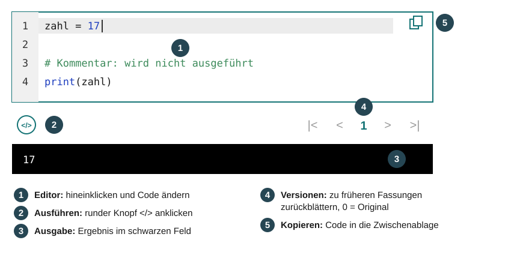

**Schritt für Schritt**

1. **Code lesen:** Lesen Sie das Programm von oben nach unten. Zeilen, die mit
   `#` beginnen, sind **Kommentare**. Sie erklären den Code und werden beim
   Ausführen übersprungen.
2. **Code ausführen:** Klicken Sie auf den runden Knopf mit dem Symbol `</>`
   links unter dem Code. Das Ergebnis erscheint im schwarzen Feld darunter.
   Beim allerersten Mal lädt der Browser Python, das dauert einige Sekunden.
3. **Code ändern:** Klicken Sie in den Code, genau wie in ein Textfeld. Ändern
   Sie z. B. eine Zahl oder einen Namen. Die Kommentare im Code sagen Ihnen,
   was sich gut zum Ändern eignet.
4. **Erneut ausführen:** Klicken Sie wieder auf `</>` und vergleichen Sie das
   neue Ergebnis mit dem alten.
5. **Zurück zum Original:** Jede ausgeführte Änderung wird als neue **Version**
   gespeichert. Mit den Pfeilen rechts unter dem Code blättern Sie zwischen den
   Versionen; **0** ist immer die ursprüngliche Fassung.

**Wenn etwas schiefgeht**

Erscheint im schwarzen Feld ein roter Text, enthält der Code einen Fehler.
Häufige Ursachen:

<!-- data-type="none" -->
| Fehlermeldung (Ausschnitt) | Ursache                                         | Lösung                                     |
| -------------------------- | ----------------------------------------------- | ------------------------------------------ |
| `SyntaxError`              | Tippfehler, z. B. fehlende Klammer oder fehlendes `"` | Klammern und Anführungszeichen prüfen |
| `IndentationError`         | Einrückung (Leerzeichen am Zeilenanfang) stimmt nicht | Zeilen im selben Block gleich weit einrücken |
| `NameError`                | ein Name ist falsch geschrieben                 | Groß-/Kleinschreibung beachten: `zahl` ≠ `Zahl` |

Im Zweifel blättern Sie mit den Versionspfeilen zurück auf **0**.

**Probieren Sie es gleich aus:** Ändern Sie den Namen und führen Sie den Code aus.

```python
# Ändern Sie den Text zwischen den Anführungszeichen, z. B. in Ihren Namen
name = "Welt"

# print() gibt Text im schwarzen Feld aus.
# Das f vor dem Anführungszeichen erlaubt es, Variablen in {} einzusetzen.
print(f"Hallo {name}!")
```
@Pyodide.eval


## 1 Informatik als Wissenschaft

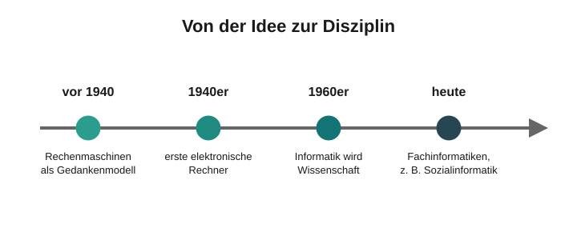

**In diesem Kapitel**

- Woher kommt der Begriff Informatik, und womit beschäftigt sie sich?
- Wie ist die Informatik entstanden?
- In welche Teilgebiete gliedert sie sich – und wo steht die Sozialinformatik?

### 1.1 Begriff und Geschichte

**Informatik** ist ein Kunstwort aus _Information_ und _Mathematik_. Im Englischen
heißt das Fach _computer science_ – das betont, dass die Informatik als einzige
Wissenschaft an einen bestimmten Maschinentyp gebunden ist: den Computer.

> **Gegenstand der Informatik** sind alle Formen der Informationsverarbeitung
> mit Hilfe von Computern.

**Zeitleiste**

<!-- data-type="none" -->
| Zeitraum           | Entwicklung                                                                 |
| ------------------ | --------------------------------------------------------------------------- |
| lange vor 1940     | computerähnliche Maschinen werden gedanklich entworfen                      |
| 1940er Jahre       | erste elektronische Rechner                                                 |
| 1960er Jahre       | Informatik formiert sich als wissenschaftliche Disziplin                    |
| Wendepunkt         | Daten **und** Programme liegen gemeinsam im Speicher – Programme lassen sich ändern, ohne die Maschine umzubauen |

Frühe Rechner hatten ihre Verarbeitungsschritte fest „verdrahtet“. Erst frei
programmierbare, elektronisch gespeicherte Algorithmen machten den Computer
zur vielseitigen Maschine, wie wir sie heute kennen.


### 1.2 Disziplinen der Informatik

Die Informatik gliedert sich in vier Teilgebiete:

<!-- data-type="none" -->
| Teilgebiet                 | Typische Fragen                                                        |
| -------------------------- | ---------------------------------------------------------------------- |
| **Theoretische Informatik** | Was ist berechenbar? Wie lassen sich Algorithmen formal beschreiben?  |
| **Technische Informatik**   | Wie funktionieren Hardware, Schaltungen und Rechnerarchitekturen?     |
| **Praktische Informatik**   | Wie entwickelt man Software, Programmiersprachen, Datenstrukturen, Betriebssysteme? |
| **Angewandte Informatik**   | Wie nutzt man Computer als Werkzeug für Aufgaben außerhalb der Informatik? |

Die ersten drei Gebiete bilden zusammen die **Kerninformatik** – sie beschäftigen
sich mit dem Computer selbst. Die **Angewandte Informatik** nutzt den Computer als
Werkzeug, etwa für Mensch-Maschine-Kommunikation, Datenbankanwendungen,
Internet oder Social Media. Die Sozialinformatik gehört zu diesen
Fachinformatiken.

Computer stecken heute längst nicht mehr nur in Geräten, die so heißen, sondern
auch in Autos, Kameras, Waschmaschinen und Industrieanlagen.


### Quiz: Disziplinen

Zu welchem Teilgebiet gehört die Frage, wie eine Klientendatenbank für eine
Beratungsstelle sinnvoll eingesetzt werden kann?

- [( )] Theoretische Informatik
- [( )] Technische Informatik
- [( )] Praktische Informatik
- [(X)] Angewandte Informatik
*******************************************************************************
Richtig: Hier wird der Computer als Werkzeug für eine Aufgabe **außerhalb** der
Informatik genutzt – das ist das Kennzeichen der Angewandten Informatik.
*******************************************************************************

Welche Teilgebiete werden unter dem Begriff **Kerninformatik** zusammengefasst?

- [[X]] Theoretische Informatik
- [[X]] Technische Informatik
- [[X]] Praktische Informatik
- [[ ]] Angewandte Informatik
- [[ ]] Sozialinformatik


## 2 Grundlagen der Informationsverarbeitung

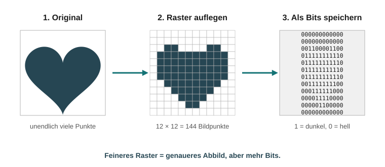

**In diesem Kapitel**

- Wie übersetzt die Informatik Dinge und Handlungen in Daten und Algorithmen?
- Was sind Symbole, Alphabete und Codes?
- Warum genügen Computern die beiden Zeichen 0 und 1?
- Was passiert bei der Digitalisierung eines Bildes oder Tons?
- Was bedeuten WAHR und FALSCH, und wie funktionieren NICHT, UND und ODER?

### 2.1 Lebenswelt und Informatik

Unsere Lebenswelt besteht aus **Dingen** (Objekten) und **Handlungen**. Dinge haben
Eigenschaften und stehen in Beziehungen zueinander. Die Informatik übernimmt
diese Denkweise mit eigenen Begriffen:

<!-- data-type="none" -->
| Lebenswelt        | Informatik      |
| ----------------- | --------------- |
| Objekte/Subjekte  | **Daten**       |
| Handlungen        | **Algorithmen** |
| Eigenschaften     | **Attribute**   |
| Beziehungen       | **Relationen**  |

Abbildung 6: Äquivalente Begriffe aus Lebenswelt und Informatik

Weil sich so viele Bereiche der Welt in Daten und Algorithmen abbilden lassen,
gilt der Computer als **Universalmaschine**.

**Die Grenze klassischer Informatik**

Klassische Programme funktionieren nur, wenn Objekte **eindeutig und vollständig**
beschreibbar sind und Handlungen **klaren Regeln** folgen.

<section class="flex-container">

<div class="flex-child">

**Gut abbildbar:** Die Abrechnung eines ambulanten Pflegeeinsatzes. Teilleistungen,
Zuschläge und Fahrtkosten sind im Leistungsvertrag eindeutig festgelegt.

</div>

<div class="flex-child">

**Kaum abbildbar:** Ein Familiensystem mit gewachsenen Beziehungsmustern,
subjektiven Erfahrungen, psychischen Dispositionen – und menschlicher
Handlungsfreiheit, die sich festen Regeln entzieht.

</div>

</section>


### 2.2 Symbole, Alphabete und Codes

Um Daten verarbeiten zu können, müssen sie als **Symbole** dargestellt werden.

- Die Zahl 1000 besteht aus den Symbolen `1` und `0`.
- Der Name „Otto“ besteht aus den Symbolen `O`, `t` und `o`.

Eine fest definierte, endliche Menge von Symbolen heißt **Alphabet**:

<!-- data-type="none" -->
| Zeichenmenge                | Alphabet                     |
| --------------------------- | ---------------------------- |
| 0, 1, 2, …, 9               | arabische Dezimalziffern     |
| I, V, X, L, C, D, M         | römische Zahlzeichen         |
| a, b, c, … A, B, C, …       | lateinische Buchstaben       |
| 0, 1                        | Binärsystem                  |

Abbildung 7: Zeichenmengen verschiedener Alphabete

Inhalte lassen sich **ohne Verlust** von einem Alphabet in ein anderes übertragen,
z. B. die römische Zahl XVII in die arabische 17. Die Zuordnungsvorschrift dafür
heißt **Code**, dargestellt in einer **Codetabelle**:

<!-- data-type="none" -->
| Binär | Dezimal | Binär | Dezimal | Binär | Dezimal |
| ----- | ------- | ----- | ------- | ----- | ------- |
| 0000  | 0       | 0011  | 3       | 0110  | 6       |
| 0001  | 1       | 0100  | 4       | 0111  | 7       |
| 0010  | 2       | 0101  | 5       | 1000  | 8       |

Abbildung 8: Codetabelle Binär – Dezimal


### 2.3 Der Binärcode

Computer arbeiten intern **ausschließlich** mit dem Binärcode, also nur mit den
Zeichen 0 und 1. Da sich alle Alphabete per Codetabelle ineinander umwandeln
lassen, kann jedes Symbol auch binär dargestellt werden.

**Wie viele Zeichen passen in eine Gruppe von Binärziffern?**

Mit $n$ Binärziffern lassen sich $2^n$ verschiedene Kombinationen bilden:

<!-- data-type="none" -->
| Stellen $n$ | Kombinationen $2^n$ | reicht für …                                             |
| ----------- | ------------------- | -------------------------------------------------------- |
| 4           | 16                  | die 10 Dezimalziffern (6 Kombinationen bleiben ungenutzt) |
| 5           | 32                  | die 26 Kleinbuchstaben: `00000` = a, `00001` = b, …       |
| 8           | 256                 | das westliche Alphabet mit Groß-/Kleinschreibung, Umlauten und Satzzeichen (ca. 200 Zeichen) |

**Ausprobieren:** Ändern Sie in der ersten Zeile die Zahl und klicken Sie auf den
runden Knopf `</>` unter dem Code. Wie das genau geht, steht in der
[Anleitung](#2).

```python
# Die Dezimalzahl, die umgewandelt werden soll.
# Probieren Sie andere Werte aus, z. B. 1, 8, 100 oder 255.
zahl = 17

# Im f-String steht hinter dem Doppelpunkt ein Format:
#   b  = als Binärzahl darstellen
#   08 = auf 8 Stellen mit führenden Nullen auffüllen (8 Bit = 1 Byte)
print(f"{zahl} (dezimal) = {zahl:08b} (binär)")

# Frage: Was passiert bei Zahlen über 255? Reichen 8 Stellen dann noch?
```
@Pyodide.eval

Und umgekehrt, von binär nach dezimal:

```python
# Eine Binärzahl als Text, also in Anführungszeichen.
# Erlaubt sind nur die Zeichen 0 und 1 – probieren Sie z. B. "0110" oder "11111111".
binaer = "10001"

# int() wandelt Text in eine Zahl um.
# Die 2 sagt Python, dass der Text im Zweiersystem (binär) geschrieben ist.
dezimal = int(binaer, 2)

print(f"{binaer} (binär) = {dezimal} (dezimal)")

# Was passiert, wenn Sie eine 2 in die Binärzahl schreiben? Lesen Sie die Fehlermeldung.
```
@Pyodide.eval


### Quiz: Binärcode

Welche Dezimalzahl entspricht der Binärzahl `0110`?

[[6]]
[[?]] Schauen Sie in die Codetabelle aus Abbildung 8.
*******************************************************************************
$0 \cdot 8 + 1 \cdot 4 + 1 \cdot 2 + 0 \cdot 1 = 6$
*******************************************************************************

Wie viele verschiedene Zeichen lassen sich mit 8 Binärziffern darstellen?

[[256]]
[[?]] Rechnen Sie $2^8$.

Ein Alphabet hat 40 Zeichen. Wie viele Binärstellen braucht man mindestens?

- [( )] 4
- [( )] 5
- [(X)] 6
- [( )] 8
*******************************************************************************
$2^5 = 32$ reicht nicht, $2^6 = 64$ reicht aus.
*******************************************************************************


### 2.4 Digitalisierung als technischer Begriff

Alles, was zähl- oder messbar ist, lässt sich in Symbolen und damit auch binär
darstellen. Was aber ist mit den Farben eines Bildes oder dem Klang eines
Orchesters? Solche physikalischen Größen können **unendlich viele Werte**
annehmen, ein Code aber nur endlich viele.

Die Lösung der Informatik: Sie ersetzt die unendlich vielen Werte durch eine
**endliche Zahl von Stufen**. Das nennt man **Rasterung** oder **Digitalisierung**
(engl. _digit_ = Ziffer).


**Digitalisierung verfälscht.** Runde Linien werden zu Treppenstufen, ein
anschwellender Ton zu einer Abfolge einzelner Pegelstufen. Je feiner das Raster,
desto geringer die Verfälschung. Liegt das Raster unter der menschlichen
Wahrnehmungsgrenze, ist das digitale Abbild nicht mehr vom Original zu
unterscheiden.

> **Achtung, zwei Bedeutungen:** Der _technische_ Digitalisierungsbegriff
> (Umwandlung analog → digital) ist zu unterscheiden vom _gesellschaftlichen_
> Begriff, der die Durchdringung aller Lebensbereiche mit digitaler Technik
> meint.


### 2.5 Bits, Bytes und Maschinenworte

<!-- data-type="none" -->
| Begriff           | Bedeutung                                                                |
| ----------------- | ------------------------------------------------------------------------ |
| **Bit**           | _binary digit_, kleinste Einheit: 0 oder 1                               |
| **Byte**          | 8 Bit – genug für das westliche Alphabet                                 |
| **Maschinenwort** | Gruppe von Bytes, die der Computer gleichzeitig transportiert und verarbeitet |

In der Normfamilie ISO 8859 ist z. B. festgelegt:

<!-- data-type="none" -->
| Zeichen | Binärcode  |
| ------- | ---------- |
| `a`     | `01100001` |
| `?`     | `00111111` |

Erscheinen in einer E-Mail seltsame Zeichen, haben Sender und Empfänger oft
unterschiedliche Codetabellen verwendet.

```python
# Der Text, dessen Zeichen in Binärcode übersetzt werden.
# Probieren Sie Ihren Namen, Satzzeichen oder ein Leerzeichen.
text = "Otto?"

# Die Schleife nimmt nacheinander jedes einzelne Zeichen aus dem Text.
# Die eingerückten Zeilen darunter werden für jedes Zeichen einmal ausgeführt.
for zeichen in text:
    # ord() schlägt die Code-Nummer des Zeichens in der Codetabelle nach,
    # z. B. 97 für "a". Mit :08b wird sie als 8-stellige Binärzahl gezeigt.
    nummer = ord(zeichen)
    print(f"{zeichen} = {nummer:08b}   (Nummer {nummer})")

# Beobachtung: Groß- und Kleinbuchstaben haben verschiedene Codes – "O" ist nicht "o".
```
@Pyodide.eval

**Maschinenworte wurden immer länger:**

<!-- data-type="none" -->
| Computer-Generation (ca.) | Länge eines Maschinenworts |
| ------------------------- | -------------------------- |
| 1970–1990                 | 1 Byte = 8 Bit             |
| 1990–2000                 | 2 Byte = 16 Bit            |
| 2000–2010                 | 4 Byte = 32 Bit            |
| ab ca. 2010               | 8 Byte = 64 Bit            |

Abbildung 10: Länge von Maschinenworten

Längere Maschinenworte bedeuten: mehr Daten pro Arbeitsschritt und größere
adressierbare Speicher.


### 2.6 Speicherkapazitäten

Speicherkapazitäten werden meist **dezimal** gezählt:

<!-- data-type="none" -->
| Einheit        | Bytes      | in Worten         |
| -------------- | ---------- | ----------------- |
| 1 Kilobyte (KB) | $10^3$    | Tausend (binär: 1024) |
| 1 Megabyte (MB) | $10^6$    | Million           |
| 1 Gigabyte (GB) | $10^9$    | Milliarde         |
| 1 Terabyte (TB) | $10^{12}$ | Billion           |
| 1 Petabyte (PB) | $10^{15}$ | Billiarde         |
| 1 Exabyte (EB)  | $10^{18}$ | Trillion          |
| 1 Zettabyte (ZB) | $10^{21}$ | Trilliarde       |

**Zur Einordnung:** 1 GB ≈ ein 10 Meter langes Bücherregal Text; 1 TB ≈ 200.000
Musikstücke à 5 Minuten. Weltweit wurden 2018 rund 33 ZB Daten erzeugt, für 2025
wurden 175 ZB prognostiziert.

**Quiz:** Ordnen Sie zu.

Ein Byte besteht aus [[ 4 | (8) | 16 | 64 ]] Bit.
Heutige Computer arbeiten meist mit Maschinenworten von [[ 8 | 16 | 32 | (64) ]] Bit.
Ein Terabyte sind [[ (1000) | 100 | 1024 ]] Gigabyte (dezimale Zählweise).


### 2.7 Logik: WAHR und FALSCH

So wie Computer nur die Zeichen 0 und 1 kennen, kennt die **Logik** nur zwei
Werte: **WAHR** und **FALSCH**. Deshalb passen beide so gut zusammen:

<!-- data-type="none" -->
| Binär | Logik  |
| ----- | ------ |
| 1     | WAHR   |
| 0     | FALSCH |

**Aussagen** sind Sätze, die entweder wahr oder falsch sind. Nehmen wir zwei
Aussagen über die Klientin Frau Becker:

- **A:** „Frau Becker ist arbeitslos.“ – das ist **WAHR**
- **B:** „Frau Becker ist in Ausbildung.“ – das ist **FALSCH**

Mit drei **logischen Verknüpfungen** lassen sich daraus neue Aussagen bilden:

<!-- data-type="none" -->
| Verknüpfung | Regel                                                  | Beispiel                                          | Ergebnis |
| ----------- | ------------------------------------------------------ | ------------------------------------------------- | -------- |
| **NICHT A** | dreht den Wert um                                      | „Frau Becker ist **nicht** arbeitslos.“            | FALSCH   |
| **A UND B** | nur WAHR, wenn **beide** Aussagen wahr sind            | „Sie ist arbeitslos **und** in Ausbildung.“       | FALSCH   |
| **A ODER B** | WAHR, wenn **mindestens eine** Aussage wahr ist        | „Sie ist arbeitslos **oder** in Ausbildung.“      | WAHR     |

**Alle Fälle auf einen Blick (Wahrheitstabelle)**

<!-- data-type="none" -->
| A      | B      | A UND B | A ODER B |
| ------ | ------ | ------- | -------- |
| FALSCH | FALSCH | FALSCH  | FALSCH   |
| FALSCH | WAHR   | FALSCH  | WAHR     |
| WAHR   | FALSCH | FALSCH  | WAHR     |
| WAHR   | WAHR   | WAHR    | WAHR     |

> **Merksatz:** UND ist streng – alles muss stimmen. ODER ist großzügig – eines
> genügt.
>
> **Achtung:** Im Alltag meint „oder“ oft „entweder … oder“. Das logische ODER ist
> auch dann WAHR, wenn **beide** Aussagen stimmen.

**Ausprobieren:** Ändern Sie `True` (wahr) und `False` (falsch) und führen Sie den
Code aus.

```python
# Zwei Aussagen über Frau Becker: True heißt wahr, False heißt falsch.
# Probieren Sie alle vier Kombinationen aus der Wahrheitstabelle aus:
# False/False, False/True, True/False und True/True.
arbeitslos = True
in_ausbildung = False

# Python gibt True und False aus. Diese kleine Tabelle übersetzt das ins Deutsche.
wort = {True: "WAHR", False: "FALSCH"}

# not  dreht den Wert um                              (NICHT)
# and  ist nur wahr, wenn BEIDE Aussagen wahr sind     (UND)
# or   ist wahr, wenn MINDESTENS EINE Aussage wahr ist (ODER)
print("NICHT arbeitslos:             ", wort[not arbeitslos])
print("arbeitslos UND in Ausbildung: ", wort[arbeitslos and in_ausbildung])
print("arbeitslos ODER in Ausbildung:", wort[arbeitslos or in_ausbildung])
```
@Pyodide.eval


### 2.8 Logik in der Praxis: Datenbankabfragen

Die logischen Grundfunktionen begegnen Ihnen ständig, z. B. bei Suchabfragen in
Fachsoftware.

- **UND:** Alle Adressaten, die männlich **und** arbeitslos sind – beide Kriterien
  müssen zutreffen.
- **ODER:** Alle Adressaten in Ausbildung **oder** im Praktikum – eines der Kriterien
  (oder beide) genügt.

```python
# Eine kleine "Datenbank" als Liste. Jede Zeile in {} ist ein Datensatz
# mit Feldern wie "name" oder "arbeitslos". True heißt wahr, False heißt falsch.
# Sie können Werte ändern oder eine weitere Zeile im gleichen Muster ergänzen.
adressaten = [
    {"name": "Arslan",    "geschlecht": "m", "arbeitslos": True,  "status": "Ausbildung"},
    {"name": "Becker",    "geschlecht": "w", "arbeitslos": True,  "status": "keiner"},
    {"name": "Costa",     "geschlecht": "m", "arbeitslos": False, "status": "Praktikum"},
    {"name": "Dietrich",  "geschlecht": "m", "arbeitslos": True,  "status": "keiner"},
    {"name": "Engel",     "geschlecht": "w", "arbeitslos": False, "status": "Ausbildung"},
]

# Abfrage 1 mit UND (and): Beide Bedingungen müssen gleichzeitig zutreffen.
# == prüft auf Gleichheit (ein einzelnes = würde einen Wert zuweisen).
und = []
for a in adressaten:
    if a["geschlecht"] == "m" and a["arbeitslos"]:
        und.append(a["name"])          # Namen an die Ergebnisliste anhängen

# Abfrage 2 mit ODER (or): Es genügt, wenn eine der Bedingungen zutrifft.
oder = []
for a in adressaten:
    if a["status"] == "Ausbildung" or a["status"] == "Praktikum":
        oder.append(a["name"])

# ", ".join(...) verbindet die Namen zu einem Text, getrennt durch Kommas.
print("männlich UND arbeitslos:  ", ", ".join(und))
print("Ausbildung ODER Praktikum:", ", ".join(oder))

# Aufgabe: Ersetzen Sie in Abfrage 1 das "and" durch "or". Wer kommt hinzu – und warum?
```
@Pyodide.eval

**Quiz:** Aussage A ist WAHR, Aussage B ist FALSCH.

A **UND** B ist [[ WAHR | (FALSCH) ]].

A **ODER** B ist [[ (WAHR) | FALSCH ]].

**NICHT** B ist [[ (WAHR) | FALSCH ]].

Eine Abfrage lautet „wohnt in der Südstadt **UND** ist älter als 80“. Welche Aussage
stimmt?

- [( )] Es werden alle Personen aus der Südstadt und zusätzlich alle über 80 ausgegeben.
- [(X)] Es werden nur Personen ausgegeben, die in der Südstadt wohnen und älter als 80 sind.
- [( )] Es werden alle Personen ausgegeben, auf die mindestens ein Kriterium zutrifft.


### 2.9 Logik im Prozessor – und darüber hinaus

Im Prozessor werden genau diese Verknüpfungen NICHT, UND und ODER ausgeführt,
von winzigen elektronischen Schaltern: Strom an steht für 1, Strom aus für 0.
Kombiniert man sehr viele solcher Verknüpfungen, kann der Computer **rechnen**
und **speichern**. Darauf beruhen **alle** Prozessoren und Speicherchips.

- Heutige Prozessor-Chips enthalten auf wenigen Quadratmillimetern **über
  20 Milliarden** Transistoren.
- Weil die physikalischen Grenzen fast erreicht sind, kombiniert man mehrere
  **Prozessorkerne** auf einem Chip.

**Ausblick: Quantencomputer**

Quantencomputer beruhen nicht auf klassischer Physik, sondern auf der
Quantenphysik. Ein **Qubit** kann nicht nur 0 oder 1 sein, sondern sich in einer
Überlagerung beider Zustände befinden. Mit $n$ Qubits lassen sich so $2^n$
Zustände gleichzeitig bearbeiten – bei 20 Qubits über eine Million.

Quantencomputer funktionieren bislang nur nahe dem absoluten Nullpunkt und sind
noch im Forschungsstadium, gelten aber als sehr zukunftsträchtig, etwa für KI
oder Big Data.


## 3 Algorithmen

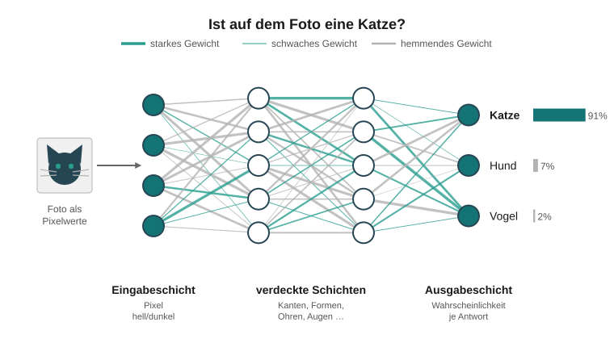

**In diesem Kapitel**

- Was ist ein Algorithmus, und was braucht ein Computer, um ihn auszuführen?
- Aus welchen vier Grundbausteinen bestehen alle Algorithmen?
- Wozu gibt es Programmiersprachen?
- Wie lernen neuronale Netze – und wo liegen die Grenzen von KI?

### 3.1 Klassische Algorithmen

Ein **Algorithmus** ist eine schrittweise Vorschrift zur Ausführung einer
Tätigkeit. Beispiele aus dem Alltag sind Kochrezepte, aus der Sozialverwaltung
etwa die Berechnung von Wohngeld.

Damit ein Computer einen Algorithmus ausführen kann, muss dieser

1. **eindeutig und präzise** sein,
2. aus einer **festen Folge von Einzelschritten** bestehen und
3. **endlich** sein, also zu einem definierten Ergebnis führen.

Typische Beispiele: Suchen und Ersetzen in der Textverarbeitung oder das
alphabetische Sortieren einer Literaturliste.


### 3.2 Die vier Elemente von Algorithmen

Alle Algorithmen sind aus wenigen Grundbausteinen zusammengesetzt:

<!-- data-type="none" -->
| Element                              | Alltagsbeispiel                                        | Beispiel aus der Pflege                                  |
| ------------------------------------ | ------------------------------------------------------ | -------------------------------------------------------- |
| **Elementare Operation**             | Schneide die Kartoffel in 1-cm-Würfel.                 | Programm starten, Text laden                             |
| **Bedingte Ausführung**              | Wenn die Soße zu dick ist, füge Wasser hinzu.          | Ein-/Ausfuhrbilanz berechnen, wenn Werte vorliegen       |
| **Bedingte Ausführung mit Alternative** | … wenn sie zu dünn ist, füge Mehl hinzu.            | Bei negativer Bilanz Warnung ausgeben, sonst Bilanz anzeigen |
| **Schleife (Iteration)**             | Rühre die Soße, bis sie fest wird.                     | Wiederhole, bis eine Endbedingung erfüllt ist            |

Abbildung 13: Elemente und Beispiele von Algorithmen

**Ausprobieren:** Eine Flüssigkeitsbilanz mit allen vier Elementen.

```python
# Eingabedaten: einzelne Trinkmengen über den Tag (in ml) und die Ausfuhr.
# Ändern Sie die Werte, bis die Bilanz positiv wird.
einfuhr = [400, 250, 300, 200]
ausfuhr = 1300

# Elementare Operation: Der Zähler für die Summe startet bei 0.
summe = 0

# Schleife (Iteration): Die eingerückte Zeile wird für jede Menge
# in der Liste einmal ausgeführt und addiert sie zur Summe.
for menge in einfuhr:
    summe = summe + menge

# Elementare Operation: Bilanz = alles Getrunkene minus Ausfuhr.
bilanz = summe - ausfuhr
print(f"Einfuhr gesamt: {summe} ml, Ausfuhr: {ausfuhr} ml")

# Bedingte Ausführung mit Alternative:
# Nur EINER der beiden eingerückten Blöcke wird ausgeführt.
if bilanz < 0:
    print(f"Warnung: Negative Flüssigkeitsbilanz ({bilanz} ml)!")
else:
    print(f"Bilanz in Ordnung: +{bilanz} ml")

# Aufgabe: Ergänzen Sie in der Liste eine weitere Trinkmenge, z. B. 250.
# Achten Sie auf das Komma zwischen den Zahlen.
```
@Pyodide.eval


### 3.3 Programmiersprachen

Eine **Programmiersprache** ist eine fest definierte Menge eindeutiger Befehle und
Syntaxregeln, mit der ein Algorithmus für den Computer formuliert wird.

<section class="flex-container">

<div class="flex-child">

**Maschinennahe Sprachen** (Assembler)

- Befehle für einen bestimmten Prozessortyp
- z. B. `load 1234` – „lade den Inhalt von Speicheradresse 1234“
- sehr aufwändig, heute nur noch für Spezialaufgaben

</div>

<div class="flex-child">

**Höhere Programmiersprachen**

- beschreiben ganze Vorgänge abstrakt
- kürzer, besser lesbar, prozessorunabhängig
- ein **Compiler** übersetzt sie in Maschinencode
- früher: Fortran, Cobol, Basic, Pascal
- heute z. B.: C++, C#, Java, Python, JavaScript

</div>

</section>

Moderne Sprachen bringen zudem **Bibliotheken** mit fertigen Routinen, grafische
Editoren und Testwerkzeuge mit.

**Quiz:** Ordnen Sie das Element zu.

„Solange noch Akten im Stapel liegen, nimm die oberste und lege sie ab.“ ist eine
[[ elementare Operation | bedingte Ausführung | (Schleife) ]].

„Wenn der Antrag vollständig ist, leite ihn weiter, sonst fordere Unterlagen
nach.“ ist eine [[ Schleife | (bedingte Ausführung mit Alternative) | elementare Operation ]].


### 3.4 Lernende Algorithmen und neuronale Netze

Klassische Programme liefern bei gleicher Eingabe **immer exakt dasselbe** Ergebnis.
Probleme, die sich nicht eindeutig beschreiben lassen – etwa das Erkennen von
Trauer, Freude oder Angst in einem Gesicht – können sie nicht lösen.

Die **Künstliche Intelligenz (KI)** setzt deshalb **lernfähige Algorithmen** ein:

1. **Neuronale Netze** bilden das Gehirn vereinfacht nach. Künstliche Neuronen
   nehmen Informationen auf und geben sie an andere Neuronen weiter.
2. Die Verbindungen haben ein **Gewicht** (positiv oder negativ).
3. **Lernen** heißt: Die Gewichte werden verändert.
4. Mehrere hintereinander geschaltete Schichten nennt man **Deep Learning**.


Jede Schicht erkennt komplexere Merkmale: erst helle und dunkle Pixel, dann
Kanten und Formen, schließlich Ohren, Augen und Schnurrhaare. Am Ende
steht eine **Wahrscheinlichkeit**, z. B. „zu 91 % eine Katze“.

Zwei besondere Bauarten neuronaler Netze stecken hinter den bekanntesten
KI-Anwendungen von heute: **Transformer** schreiben Texte, **Diffusionsmodelle**
erzeugen Bilder. Beide werden auf den folgenden Seiten erklärt.


#### Transformer: Wie KI Texte schreibt

Chatbots wie ChatGPT, Claude oder Gemini beruhen auf einer Bauart neuronaler
Netze, die **Transformer** heißt. Sie wurde 2017 von einem Forschungsteam bei
Google vorgestellt (Vaswani u. a. 2017). Das „T“ in **GPT** steht dafür:
_Generative Pre-trained Transformer_.

Im Kern lösen diese Sprachmodelle eine einzige, einfache Aufgabe: **Sie sagen das
nächste Wort voraus.**

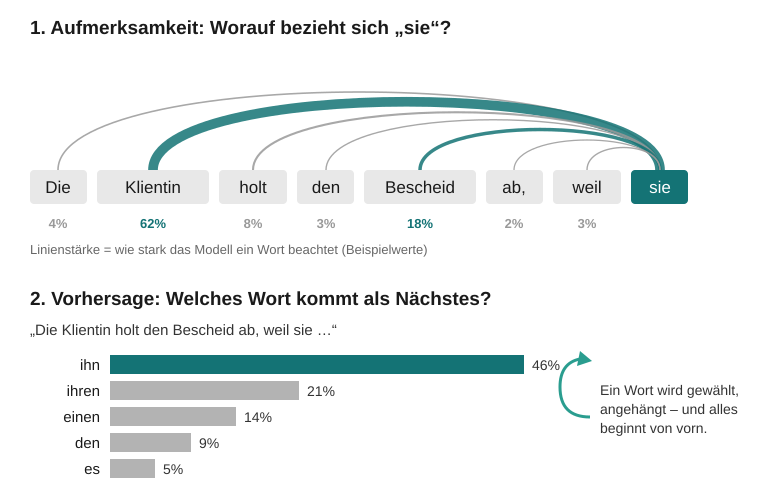

**So geht ein Transformer Schritt für Schritt vor**

1. **Text in Stücke zerlegen:** Der Text wird in kleine Einheiten, sogenannte
   **Tokens**, zerlegt – meist ganze Wörter oder Wortteile.
2. **Wörter in Zahlen übersetzen:** Jedes Token wird in eine lange Reihe von
   Zahlen umgewandelt. Wörter mit ähnlicher Bedeutung bekommen ähnliche
   Zahlenreihen, z. B. „Klientin“ und „Adressatin“.
3. **Aufmerksamkeit (_Attention_):** Für jedes Wort berechnet das Netz, wie
   wichtig die anderen Wörter im Text dafür sind. Im Satz „Die Klientin holt den
   Bescheid ab, weil sie …“ achtet das Modell bei „sie“ vor allem auf „Klientin“ –
   so erkennt es, worauf sich das Wort bezieht. Das ist die zentrale Neuerung des
   Transformers.
4. **Viele Schichten:** Dieser Schritt wird in Dutzenden Schichten hintereinander
   wiederholt. Jede Schicht erfasst komplexere Zusammenhänge – ähnlich wie beim
   Bilderkennungs-Netz auf der vorigen Seite.
5. **Nächstes Wort wählen:** Am Ende steht für jedes mögliche nächste Wort eine
   **Wahrscheinlichkeit**. Ein Wort wird ausgewählt, an den Text angehängt – und
   alles beginnt von vorn. So entsteht eine Antwort Wort für Wort.

**Wie lernt ein Transformer?** Beim Training liest das Modell riesige Mengen Text
und versucht immer wieder, das jeweils nächste Wort vorherzusagen. Liegt es
falsch, werden die Gewichte seiner Verbindungen ein wenig angepasst – genau wie
bei den neuronalen Netzen oben beschrieben.

**Warum Transformer so erfolgreich sind:** Ältere Sprachmodelle mussten einen Text
Wort für Wort nacheinander verarbeiten. Ein Transformer betrachtet alle Wörter
eines Textes **gleichzeitig**. Dadurch lässt er sich auf vielen Prozessoren
parallel und damit mit sehr viel mehr Text trainieren (Vaswani u. a. 2017).

> **Wichtig für die Praxis:** Ein Sprachmodell erzeugt Text, der
> **wahrscheinlich klingt** – nicht Text, der geprüft wahr ist. Es kann daher
> überzeugend formulierte, aber falsche Aussagen liefern (sogenannte
> „Halluzinationen“). Angaben zu Rechtsansprüchen, Fristen oder Personen müssen
> Sie immer selbst prüfen. Und: Personenbezogene Daten von Klientinnen und
> Klienten gehören nicht in öffentliche KI-Dienste (vgl. Kapitel 8).

**Ausprobieren:** Ein winziges Sprachmodell, das nur zählt, welches Wort in einigen
Beispielsätzen auf welches folgt.

```python
# Ein stark vereinfachtes "Sprachmodell": Es zählt, welches Wort in den
# Beispielsätzen auf welches folgt. Daraus berechnet es, wie wahrscheinlich
# jedes mögliche nächste Wort ist.
# Ein echter Transformer lernt aus Milliarden Texten und beachtet mit seiner
# Aufmerksamkeit den GANZEN bisherigen Text – nicht nur das letzte Wort.
from collections import Counter, defaultdict

# Die "Trainingsdaten". Ergänzen Sie eigene Sätze in Kleinbuchstaben.
texte = [
    "die klientin stellt einen antrag",
    "die klientin braucht einen termin",
    "die fachkraft stellt einen bescheid aus",
    "die fachkraft braucht einen termin",
]

# Training: Für jedes Wortpaar zählen, wie oft das zweite auf das erste folgt.
folgt = defaultdict(Counter)
for satz in texte:
    woerter = satz.split()                          # Satz in Wörter (Tokens) zerlegen
    for wort, naechstes in zip(woerter, woerter[1:]):
        folgt[wort][naechstes] += 1

# Vorhersage: Welche Wörter folgen auf das Startwort, und wie wahrscheinlich?
# Probieren Sie andere Startwörter, z. B. "die", "klientin" oder "stellt".
start = "einen"
gesamt = sum(folgt[start].values())
print(f"Nach '{start}' folgt:")
for kandidat, anzahl in folgt[start].most_common():
    print(f"  {kandidat:10} {anzahl / gesamt:.0%}")

# Text erzeugen: immer das wahrscheinlichste nächste Wort anhängen,
# bis kein Nachfolger mehr bekannt ist (höchstens 8 Wörter).
text = ["die"]
while text[-1] in folgt and len(text) < 8:
    naechstes, _ = folgt[text[-1]].most_common(1)[0]
    text.append(naechstes)
print("\nErzeugter Text:", " ".join(text))

# Beobachtung: Der erzeugte Satz steht so in keinem der Trainingssätze –
# er klingt plausibel, ist aber nicht ganz sinnvoll. Nach demselben Prinzip
# entstehen bei großen Sprachmodellen überzeugend klingende Fehler.
```
@Pyodide.eval

**Quellen**

- Vaswani, Ashish u. a. (2017): Attention Is All You Need. In: Advances in Neural
  Information Processing Systems 30. Online: <https://arxiv.org/abs/1706.03762>
- Alammar, Jay (2018): The Illustrated Transformer. Online:
  <https://jalammar.github.io/illustrated-transformer/>
- Google for Developers: Machine Learning Crash Course – LLMs: Was ist ein Large
  Language Model? Online:
  <https://developers.google.com/machine-learning/crash-course/llm/transformers?hl=de>
- Sanderson, Grant (3Blue1Brown) (2024): Attention in transformers, step-by-step.
  Video mit Erläuterungen. Online: <https://www.3blue1brown.com/lessons/attention>

Alle Online-Quellen abgerufen am 29.10.2026.


#### Diffusionsmodelle: Wie KI Bilder erzeugt

Bildgeneratoren wie Stable Diffusion erzeugen aus einer kurzen Textbeschreibung
(einem **Prompt**) ein neues Bild. Die meisten heutigen Bildgeneratoren beruhen auf
**Diffusionsmodellen**. Die Grundidee ist überraschend: Das Netz lernt,
**Rauschen aus Bildern zu entfernen**.

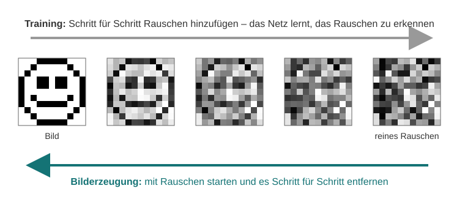

**Training: Bilder Schritt für Schritt verrauschen**

1. Man nimmt sehr viele Bilder mit Bildbeschreibungen.
2. Jedem Bild wird in vielen kleinen Schritten etwas zufälliges Rauschen
   hinzugefügt – so lange, bis nur noch „Schnee“ wie bei einem alten Fernseher
   übrig ist.
3. Das neuronale Netz bekommt jeweils ein verrauschtes Bild und lernt
   vorherzusagen, **welches Rauschen** hinzugefügt wurde (Ho/Jain/Abbeel 2020).

**Bilderzeugung: den Vorgang umkehren**

1. Das Modell startet mit einem Bild aus **reinem Zufallsrauschen**.
2. In jedem Schritt schätzt das Netz, welcher Teil davon Rauschen ist, und zieht
   ihn ab. Nach typischerweise 20 bis 50 Schritten ist ein klares Bild entstanden.
3. Der **Prompt** steuert jeden dieser Schritte: Ein Textmodell übersetzt die
   Beschreibung in Zahlen, und das Netz entfernt das Rauschen so, dass ein dazu
   passendes Bild entsteht. Dieses Textmodell ist übrigens selbst ein Transformer.

**Ein Trick für mehr Tempo:** Stable Diffusion arbeitet nicht direkt mit den
Millionen Bildpunkten, sondern mit einer stark verkleinerten, „komprimierten“
Fassung des Bildes. Erst am Ende wird daraus das Bild in voller Größe berechnet.
Das spart sehr viel Rechenleistung (Rombach u. a. 2022).

**Darum ist jedes Bild anders:** Weil der Startpunkt zufälliges Rauschen ist,
liefert derselbe Prompt bei jedem Versuch ein anderes Bild.

> **Wichtig für die Praxis:** Diffusionsmodelle erzeugen täuschend echte Bilder
> von Personen und Situationen, die es nie gab (**Deepfakes**). Sie übernehmen
> zudem Klischees aus ihren Trainingsbildern, z. B. bei der Darstellung von
> Berufen, Geschlechtern oder Herkunft. Bilder aus dem Netz sollten Sie daher
> kritisch prüfen – und bei eigenen Materialien auf vielfältige Darstellungen
> achten.

**Quellen**

- Ho, Jonathan/Jain, Ajay/Abbeel, Pieter (2020): Denoising Diffusion
  Probabilistic Models. In: Advances in Neural Information Processing Systems 33.
  Online: <https://arxiv.org/abs/2006.11239>
- Rombach, Robin u. a. (2022): High-Resolution Image Synthesis with Latent
  Diffusion Models. In: Proceedings of the IEEE/CVF Conference on Computer Vision
  and Pattern Recognition (CVPR). Online: <https://arxiv.org/abs/2112.10752>
- Alammar, Jay (2022): The Illustrated Stable Diffusion. Online:
  <https://jalammar.github.io/illustrated-stable-diffusion/>

Alle Online-Quellen abgerufen am 29.10.2026.


#### Quiz: Transformer und Diffusion

Welche Aufgabe löst ein Transformer-Sprachmodell im Kern?

- [( )] Es schlägt Fakten in einer geprüften Datenbank nach.
- [(X)] Es sagt immer wieder das wahrscheinlichste nächste Wort voraus.
- [( )] Es versteht Texte genauso wie ein Mensch.
- [( )] Es kopiert passende Sätze aus seinen Trainingstexten.

Wofür sorgt die **Aufmerksamkeit** (_Attention_) im Transformer?

- [( )] Sie sorgt dafür, dass das Modell schneller tippt.
- [(X)] Sie bestimmt, welche anderen Wörter für die Bedeutung eines Wortes wichtig sind.
- [( )] Sie prüft, ob eine Antwort wahr ist.

Womit beginnt ein Diffusionsmodell, wenn es ein neues Bild erzeugt?

- [( )] mit einer Skizze aus dem Internet
- [( )] mit dem ähnlichsten Trainingsbild
- [(X)] mit reinem Zufallsrauschen
- [( )] mit einem weißen Blatt

Welche Aussagen sind richtig?

- [[X]] Derselbe Prompt kann bei jedem Versuch ein anderes Bild ergeben.
- [[ ]] Ein Sprachmodell gibt nur Aussagen aus, die geprüft wahr sind.
- [[X]] Beim Training von Diffusionsmodellen wird Bildern schrittweise Rauschen hinzugefügt.
- [[X]] Klientendaten gehören nicht in öffentliche KI-Dienste.


### 3.5 Stärken und Grenzen von KI

<section class="flex-container">

<div class="flex-child">

**Stärken**

- lernt sehr schnell aus großen Datenmengen
- stark, wo kaum systematisches Wissen vorliegt
- Text- und Spracherkennung, Übersetzung
- Bild- und Gesichtserkennung
- Orientierung autonomer Fahrzeuge und Roboter
- teils besser als Fachleute, z. B. bei der Erkennung von Hautkrebs

</div>

<div class="flex-child">

**Grenzen**

- im Kern mathematisch-statistische Operationen
- braucht große Mengen Trainingsdaten
- kann nicht „quer denken“ oder echt Neues erfinden
- arbeitet nur innerhalb gegebener Kontextbedingungen
- kann das eigene Tun nicht reflektieren oder dessen Sinn hinterfragen

</div>

</section>

**Quiz:** Welche Aussagen über neuronale Netze sind richtig?

- [[X]] Sie lernen, indem die Gewichte der Verbindungen verändert werden.
- [[ ]] Sie liefern bei gleicher Eingabe garantiert immer dasselbe Ergebnis, weil sie fest programmiert sind.
- [[X]] Mehrschichtige Netze werden als Deep Learning bezeichnet.
- [[ ]] Sie können den Sinn ihrer eigenen Entscheidungen reflektieren.
- [[X]] Sie liefern ihr Ergebnis häufig als Wahrscheinlichkeit.


## 4 Systemarchitekturen

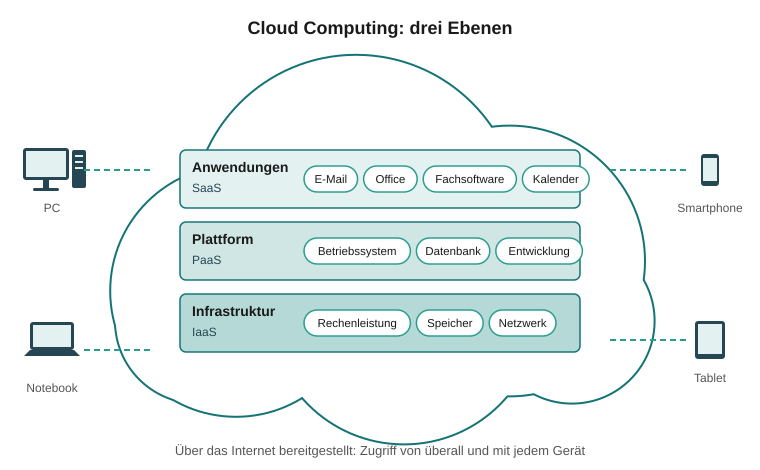

**In diesem Kapitel**

- Aus welchen Bausteinen besteht jeder Computer?
- Wie sind lokale Netzwerke in sozialen Einrichtungen aufgebaut?
- Was ist Server Based Computing, und warum spart es Kosten?
- Wie funktionieren VPN, TCP/IP und das Internet?
- Welche Formen und Servicemodelle der Cloud gibt es?

### 4.1 Aufbau eines Computers

Der Grundaufbau aller Computer ist seit über 50 Jahren gleich geblieben – vom
Großrechner bis zum Smartphone:

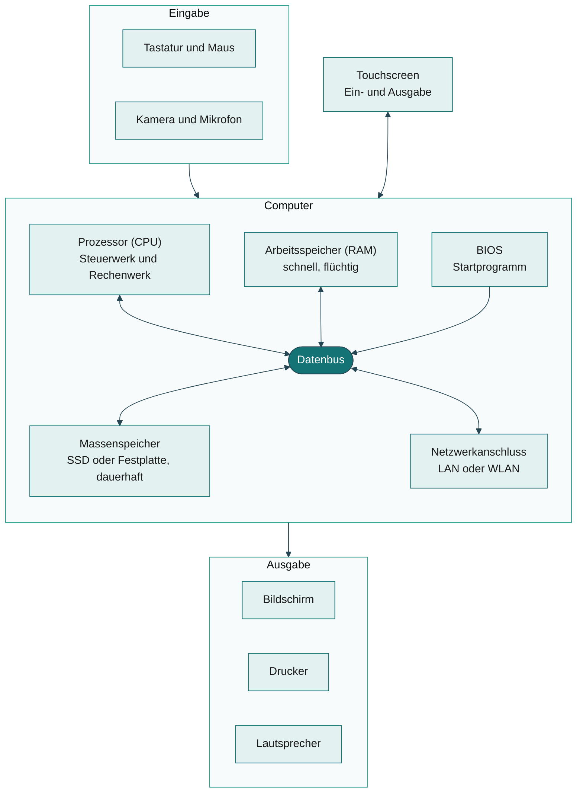

<!-- data-type="none" -->
| Baustein                   | Aufgabe                                                                                      |
| -------------------------- | -------------------------------------------------------------------------------------------- |
| **Prozessor (CPU)**        | Rechenwerk führt Operationen aus, Steuerwerk steuert sie. Heute teils über 20 Mrd. Operationen pro Sekunde. |
| **Arbeitsspeicher (RAM)**  | schneller Zwischenspeicher für den Prozessor; **flüchtig** – Inhalt geht beim Ausschalten verloren |
| **BIOS**                   | fest eingebaut, steuert Prüf- und Startroutinen beim Einschalten                             |
| **Massenspeicher**         | dauerhafte Speicherung: Festplatte (HD) oder Solid State Drive (SSD)                         |
| **Datenbus**               | transportiert Daten und Befehle zwischen den Bausteinen                                      |
| **Peripherie**             | Eingabe (Tastatur, Maus, Kamera, Mikrofon) und Ausgabe (Bildschirm, Drucker, Lautsprecher, VR-/AR-Brillen) |

Touchscreens sind Ein- **und** Ausgabegerät zugleich.

**Quiz:** Sie schreiben einen Bericht, und plötzlich fällt der Strom aus. Wo war
der noch nicht gespeicherte Text abgelegt?

- [( )] auf der SSD
- [(X)] im Arbeitsspeicher (RAM)
- [( )] im BIOS
- [( )] auf dem Datenbus
*******************************************************************************
Der Arbeitsspeicher ist flüchtig. Erst beim Speichern wird der Text dauerhaft
auf den Massenspeicher (SSD oder Festplatte) geschrieben.
*******************************************************************************


### 4.2 Netzwerke

Computer-Netzwerke verbinden Geräte, um Daten auszutauschen oder Funktionen auf
entfernten Rechnern zu nutzen. Nach ihrer Ausdehnung unterscheidet man:

<!-- data-type="none" -->
| Abkürzung | Bedeutung                     | Beispiel                        |
| --------- | ----------------------------- | ------------------------------- |
| **LAN**   | Local Area Network, kabelgebunden | Netz in einem Gebäude       |
| **W-LAN** | Wireless LAN, per Funk        | Tablets und Smartphones im Büro |
| **WAN**   | Wide Area Network             | Verbindung mehrerer Standorte   |

**Bausteine eines lokalen Netzes**

- **Server:** stellt Daten und Programme bereit und regelt die Zugriffsrechte.
  Auf ihm wird nicht direkt gearbeitet.
- **Clients:** die Arbeitsplatzrechner und Mobilgeräte.
- **Switch:** regelt den Datenverkehr im Netz.
- **Router:** verbindet das Netz mit dem Internet.
- **Accesspoint:** sendet und empfängt Funksignale für Mobilgeräte.

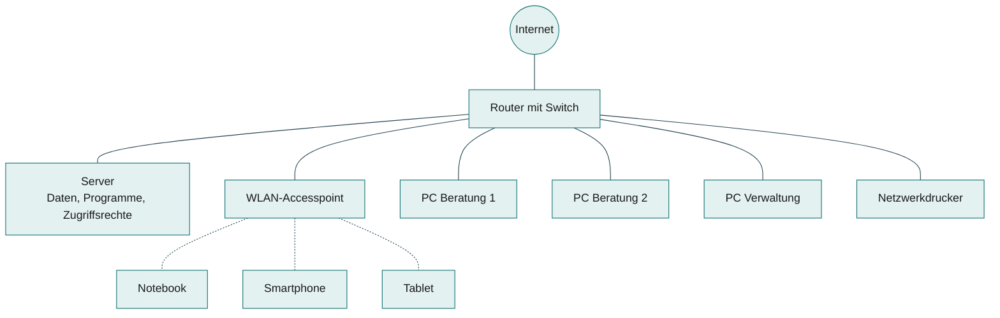

Kleines Netzwerk einer Beratungsstelle: durchgezogene Linien sind Kabel (LAN),
gepunktete Linien Funkverbindungen (WLAN).

Eine Sonderform ist das **Peer-to-Peer-Netz** ohne eigenen Server: Jeder Rechner
ist Client und Server zugleich. Es eignet sich nur für einfachen Datenaustausch
oder gemeinsame Drucker.


### 4.3 Server Based Computing

Bei vielen PCs wird die Verwaltung teuer: Fehlerbehebung, Updates, Sicherheit.
Diese Kosten übersteigen oft die Anschaffungskosten um ein Vielfaches. Die
Gesamtkosten über den Lebenszyklus heißen **Total Cost of Ownership (TCO)**.

**Lösung: Terminal-Server-Architektur**

Statt PCs stehen an den Arbeitsplätzen **Thin Clients**, die nur Ein- und Ausgabe
übernehmen. Die gesamte Verarbeitung läuft auf leistungsstarken Servern.

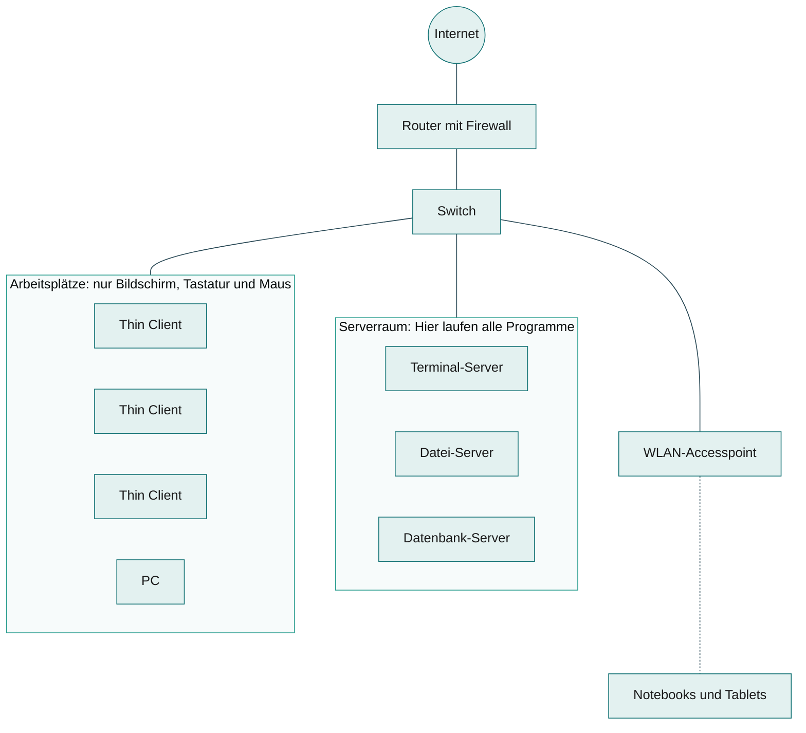

Größeres Netz mit Terminal-Server: Die Programme laufen im Serverraum, an den
Arbeitsplätzen kommen nur Bild und Eingaben an.

<section class="flex-container">

<div class="flex-child">

**Vorteile**

- kaum Administrationsaufwand am Arbeitsplatz
- Thin Clients sind günstiger, langlebiger, stromsparender
- deutlich niedrigere TCO
- PCs, Notebooks, Mobilgeräte weiter einbindbar

</div>

<div class="flex-child">

**Nachteile**

- hohe Abhängigkeit von Netz und Servern
- Ausfallsicherheit muss professionell organisiert werden

</div>

</section>

**Variante: Desktop-Virtualisierung.** Auch hier liegt alles zentral auf dem
Server, aber jeder Client bekommt eine **eigene virtuelle Betriebssystem-Instanz**.
Das kostet mehr Serverressourcen, hilft aber bei Anwendungen, die auf Terminal-
Servern nicht laufen, oder bei sehr individuellen Konfigurationen.


### 4.4 Weitverkehrsnetze und Protokolle

**Weitverkehrsnetze (WAN)** verbinden Außenstellen und Standorte – heute fast
immer über das Internet. Damit die Daten im öffentlichen Netz geschützt sind,
nutzt man:

- **VPN (Virtuelles Privates Netzwerk):** Daten werden vor dem Versand
  verschlüsselt und beim Empfänger entschlüsselt.
- **MPLS-Netze:** für stabile Verbindungen mit garantierter Bandbreite, verhalten
  sich fast wie eine feste Standleitung.

**Netzwerk-Protokolle** sind Standards für die Datenübertragung zwischen
unterschiedlichen Systemen. Sie verpacken Daten in **Pakete** – wie ein Postpaket
mit Absender, Empfänger und Prüfinformationen.

Das wichtigste Protokoll ist **TCP/IP**:

- **IP** (Internet Protocol): Adressierung – jedes Gerät hat eine IP-Adresse, und
  jedes Paket trägt Absender- und Empfängeradresse
- **TCP** (Transmission Control Protocol): zuverlässiger Transport – baut die
  Verbindung auf und ab, nummeriert die Pakete und fordert verlorene neu an


### 4.5 Internet und Intranet

Technisch ist das **Internet** ein sehr großes Weitverkehrsnetz mit dem Protokoll
TCP/IP – ein „Netz zwischen den Netzen“. Es hat **keinen einzelnen Besitzer**,
sondern ist eine gemeinsame technische Konvention.

<!-- data-type="none" -->
| Zeit       | Entwicklung                                         |
| ---------- | --------------------------------------------------- |
| 1960er     | militärische Ursprünge                              |
| 1980er     | Nutzung vor allem in der Forschung                  |
| ab 1993    | grafische Oberfläche (WWW) – rasante Verbreitung    |
| heute      | Universalnetz für Medien, Telefonie, Internet der Dinge (IoT) |

**Wichtige Internet-Dienste**

<!-- data-type="none" -->
| Protokoll          | Zweck                                                              |
| ------------------ | ------------------------------------------------------------------ |
| **HTTP / HTTPS**   | Webseiten; HTTPS verschlüsselt die Übertragung                     |
| **SMTP**           | E-Mails versenden                                                  |
| **POP / IMAP**     | E-Mails empfangen; mit IMAP bleiben die Mails auf dem Server (heute üblich) |
| **FTP**            | große Datenmengen übertragen                                       |

Ein **Intranet** ist ein geschlossenes, organisationsinternes Netz mit derselben
Technik. Es wird per Browser genutzt und durch Firewalls, Benutzerkennungen und
Passwörter geschützt.

**Quiz:** Welches Protokoll sorgt dafür, dass Ihre Eingaben in einem Online-
Beratungsformular verschlüsselt übertragen werden?

- [( )] HTTP
- [(X)] HTTPS
- [( )] FTP
- [( )] SMTP

Zwei Standorte eines Trägers sollen sicher über das Internet verbunden werden.
Welche Technik ist dafür gedacht?

[[VPN]]
[[?]] Drei Buchstaben – die Daten werden verschlüsselt durch einen „Tunnel“ geschickt.


#### Beispiel: Was passiert beim Aufruf einer Webseite?

Sie tippen in der Beratungsstelle `https://www.example.org/` in den Browser und
drücken Enter. Bis die Seite erscheint, vergeht weniger als eine Sekunde – und
doch arbeiten dabei mehrere Protokolle zusammen.

**Schritt 0: Die Adresse lesen**

Eine Web-Adresse heißt **URL** (_Uniform Resource Locator_). Sie besteht aus
mehreren Teilen:

<!-- data-type="none" -->
| Teil       | Beispiel           | Bedeutung                                         |
| ---------- | ------------------ | ------------------------------------------------- |
| Protokoll  | `https`            | Wie wird übertragen? Hier: verschlüsselt          |
| Rechnername | `www.example.org` | Welcher Server? Ein Name, den Menschen sich merken können |
| Pfad       | `/`                | Welche Seite auf diesem Server? `/` ist die Startseite |

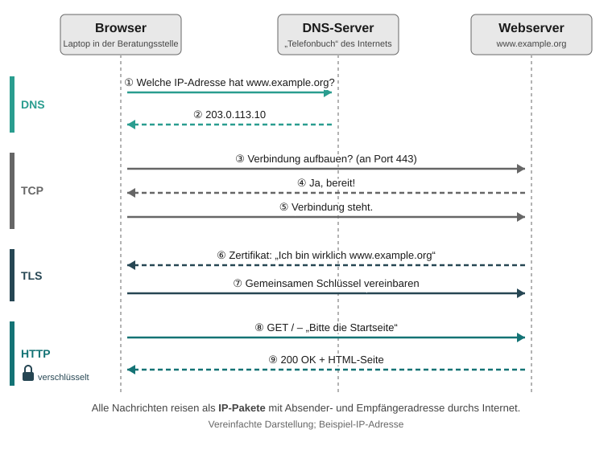

**Schritt 1–2: DNS – den Namen in eine Adresse übersetzen**

Computer finden sich im Internet nicht über Namen, sondern über **IP-Adressen**
wie `203.0.113.10`. Der Browser fragt daher zuerst einen **DNS-Server**
(_Domain Name System_): „Welche IP-Adresse gehört zu `www.example.org`?“ DNS
funktioniert wie ein Telefonbuch: Man kennt den Namen und schlägt die Nummer
nach. Die Antwort wird eine Zeit lang zwischengespeichert, damit nicht bei
jedem Klick neu gefragt werden muss.

**Schritt 3–5: TCP – eine Verbindung aufbauen**

Mit der IP-Adresse baut der Browser eine **TCP-Verbindung** zum Webserver auf.
Dafür tauschen beide drei kurze Nachrichten aus („Verbindung aufbauen?“ –
„Ja, bereit!“ – „Verbindung steht.“). Die Anfrage geht an **Port 443**: Ein
Port ist wie eine Zimmernummer im Gebäude und sagt dem Server, welcher Dienst
gemeint ist – 443 steht für HTTPS.

**Schritt 6–7: TLS – Echtheit prüfen und verschlüsseln**

Das „S“ in HTTPS steht für _secure_. Bevor Inhalte fließen, legt der Server ein
**Zertifikat** vor, das bestätigt: „Ich bin wirklich `www.example.org`.“ Der
Browser prüft es und zeigt bei Erfolg ein **Schloss-Symbol** an. Dann
vereinbaren beide einen gemeinsamen Schlüssel. Ab jetzt ist alles verschlüsselt
– wer die Daten unterwegs abfängt, sieht nur Zeichensalat. Dieses Protokoll
heißt **TLS** (_Transport Layer Security_).

**Schritt 8–9: HTTP – die Seite anfordern**

Jetzt erst kommt **HTTP** zum Zug. Der Browser schickt eine Anfrage, der Server
antwortet mit einem **Statuscode** und der Seite. Vereinfacht sieht das so aus:

```text
GET / HTTP/1.1
Host: www.example.org
Accept-Language: de
```

```text
HTTP/1.1 200 OK
Content-Type: text/html; charset=utf-8

<!DOCTYPE html>
<html> ... </html>
```

Die Seite enthält Verweise auf Bilder, Schriften und Layout-Dateien. Für jede
davon schickt der Browser eine weitere HTTP-Anfrage – oft Dutzende pro Seite.

<!-- data-type="none" -->
| Statuscode | Bedeutung                     | Wann?                                      |
| ---------- | ----------------------------- | ------------------------------------------ |
| **200**    | OK                            | Alles in Ordnung, die Seite kommt          |
| **301**    | dauerhaft umgezogen           | Der Browser wird zur neuen Adresse geleitet |
| **404**    | nicht gefunden                | Die Seite gibt es (nicht mehr)             |
| **500**    | Serverfehler                  | Auf dem Server ist etwas schiefgegangen    |

**Wer macht was? – Die Protokolle im Überblick**

Die Protokolle arbeiten wie beim Versand eines wichtigen Briefes zusammen:

<!-- data-type="none" -->
| Protokoll | Aufgabe                                         | Vergleich mit der Post                       |
| --------- | ----------------------------------------------- | -------------------------------------------- |
| **DNS**   | Name → IP-Adresse                               | Adresse im Telefonbuch nachschlagen          |
| **IP**    | Pakete adressieren und durchs Netz leiten       | Anschrift auf dem Umschlag                   |
| **TCP**   | zuverlässige Verbindung, nichts geht verloren   | Einschreiben mit Rückschein                  |
| **TLS**   | Echtheit prüfen, verschlüsseln                  | Ausweis zeigen und versiegelter Umschlag     |
| **HTTP**  | Anfrage und Antwort mit dem eigentlichen Inhalt | der Brief selbst                             |

**Ausprobieren 1:** Eine URL in ihre Teile zerlegen.

```python
# urlparse() zerlegt eine Web-Adresse in ihre Bestandteile.
# Probieren Sie andere Adressen aus, z. B. "http://example.org:8080/test?x=1".
from urllib.parse import urlparse

url = "https://www.example.org/beratung/termine.html"
teile = urlparse(url)

print("Protokoll:  ", teile.scheme)
print("Rechnername:", teile.hostname)
# Fehlt die Portangabe in der URL, gilt der Standard-Port des Protokolls.
standard_port = {"http": 80, "https": 443}
print("Port:       ", teile.port or standard_port.get(teile.scheme))
print("Pfad:       ", teile.path)
```
@Pyodide.eval

**Ausprobieren 2:** Eine echte DNS-Abfrage, live aus Ihrem Browser.

```python
# Der Browser darf aus Sicherheitsgründen kein klassisches DNS sprechen.
# Deshalb nutzen wir "DNS über HTTPS": Wir fragen den öffentlichen
# DNS-Dienst von Google (dns.google) per HTTPS nach der IP-Adresse.
# Hinweis: Dabei erfährt Google, welchen Namen Sie nachschlagen.
from pyodide.http import pyfetch

# Probieren Sie andere Namen aus, z. B. "de.wikipedia.org" oder den Namen
# der Webseite Ihrer Hochschule.
name = "www.example.org"

# type=A bedeutet: Wir möchten die IPv4-Adresse wissen.
antwort = await pyfetch(f"https://dns.google/resolve?name={name}&type=A")
daten = await antwort.json()

# Typ 5 (CNAME) ist ein Spitzname, der auf einen anderen Namen verweist,
# Typ 1 (A) ist die eigentliche IP-Adresse. Große Webseiten liefern oft
# mehrere IP-Adressen, um die Last auf mehrere Server zu verteilen.
typen = {1: "IP-Adresse", 5: "Alias für"}
print(f"DNS-Antwort für {name}:")
for eintrag in daten.get("Answer", []):
    art = typen.get(eintrag["type"], f"Typ {eintrag['type']}")
    print(f"  {eintrag['name']:35} {art:11} {eintrag['data']}")

if "Answer" not in daten:
    print("  Keine Adresse gefunden – ist der Name richtig geschrieben?")
```
@Pyodide.eval

**Quiz:** Bringen Sie den Ablauf in die richtige Reihenfolge.

Zuerst fragt der Browser den [[ Webserver | (DNS-Server) | Router ]] nach der
IP-Adresse. Dann baut er mit [[ HTTP | DNS | (TCP) ]] eine Verbindung auf. Mit
[[ (TLS) | FTP | IP ]] werden Echtheit geprüft und Daten verschlüsselt. Zuletzt
fordert er mit [[ SMTP | (HTTP) | DNS ]] die Seite an.

Sie rufen eine Seite auf und sehen die Meldung „404“. Was bedeutet das?

- [( )] Der Server ist überlastet.
- [(X)] Die angeforderte Seite wurde auf dem Server nicht gefunden.
- [( )] Die Verbindung ist nicht verschlüsselt.
- [( )] Der DNS-Server kennt den Namen nicht.

Warum braucht man DNS überhaupt?

- [( )] Damit Webseiten verschlüsselt übertragen werden.
- [(X)] Weil Computer sich über IP-Adressen finden, Menschen sich aber Namen besser merken.
- [( )] Damit E-Mails ankommen.


### 4.6 Cloud Computing

**Cloud Computing** bezeichnet IT-Infrastruktur, die über das Internet bereitgestellt
wird. Fast jede Mobil-App nutzt heute eine Cloud. Die Idee ist alt – früher sprach
man von Rechenzentrumsdienstleistungen, ASP oder IT-Outsourcing.

**Betriebsformen**

<!-- data-type="none" -->
| Form              | Merkmale                                                                                     | Beispiele                       |
| ----------------- | -------------------------------------------------------------------------------------------- | ------------------------------- |
| **Public Cloud**  | offen für alle; Daten verschiedener Nutzer liegen auf denselben Systemen, Speicherort oft unbekannt | Google Mail, Dropbox, Microsoft 365 |
| **Private Cloud** | selbst betrieben oder physisch getrennt im Rechenzentrum; orts- und geräteunabhängiger Zugriff | eigene Cloud eines Trägers |
| **Hybrid Cloud**  | Mischform: unkritische Dienste öffentlich, datenschutzkritische intern; setzt Datenklassifizierung voraus | Office online, Klientendaten intern |


### 4.7 Servicemodelle der Cloud

<!-- data-type="none" -->
| Modell                                 | Was wird bereitgestellt?                                   | Was verwaltet der Kunde?           |
| -------------------------------------- | ---------------------------------------------------------- | ---------------------------------- |
| **IaaS** – Infrastructure as a Service | virtuelle Hardware: Rechen- und Speicherkapazität          | Betriebssystem, Programme, Daten   |
| **PaaS** – Platform as a Service       | zusätzlich Betriebs- oder Entwicklungsumgebung             | Programme und Daten                |
| **SaaS** – Software as a Service       | fertige Anwendungen samt Infrastruktur                     | nur noch die Nutzung und die Daten |

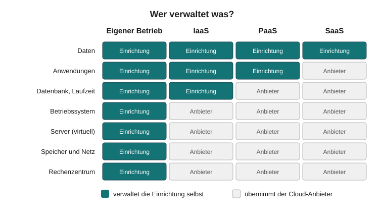

**Paradigmenwechsel:** Endgeräte werden zunehmend auf Ein- und Ausgabe reduziert,
lokale Server werden überflüssig.

**Sicherheit:** Datenschutz und IT-Sicherheit werden oft als Hindernis genannt,
besonders bei Speicherorten außerhalb der EU. Professionelle Rechenzentren sind
aber meist **besser geschützt** als der lokale IT-Betrieb vieler sozialer
Organisationen. Entscheidend sind Konfiguration, Verträge und Speicherort.

**Quiz:** Ordnen Sie zu.

Eine Einrichtung nutzt eine online bereitgestellte Fachsoftware für die
Lohnabrechnung, ohne eigene Server: [[ IaaS | PaaS | (SaaS) ]]

Ein Träger mietet virtuelle Server und installiert seine Programme selbst:
[[ (IaaS) | PaaS | SaaS ]]

Office-Dienste laufen beim öffentlichen Anbieter, die Klientendaten bleiben im
eigenen Haus: [[ Public Cloud | Private Cloud | (Hybrid Cloud) ]]


## 5 Datenbanken

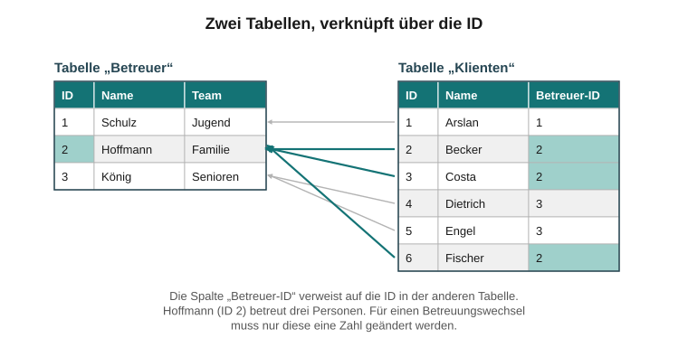

**In diesem Kapitel**

- Wie arbeiten Fachsoftware und Datenbank zusammen?
- Wie speichert eine relationale Datenbank Informationen in Tabellen?
- Wozu dient die ID, und wie werden Tabellen verknüpft?
- Was bedeuten Mehrbenutzerbetrieb und SQL?

### 5.1 Datenbank und Anwendungsprogramm

Fast jede Fachsoftware für soziale Organisationen – ebenso Suchmaschinen,
Online-Shops und soziale Medien – beruht auf einer **Datenbank**.

Für die Nutzenden wirken Programm und Datenbank wie eine Einheit. Technisch sind
sie getrennt:

<!-- data-type="none" -->
| Komponente               | Aufgabe                                                        |
| ------------------------ | -------------------------------------------------------------- |
| **Anwendungsprogramm**   | Bearbeitung: Suchen, Ändern, Kombinieren, Formulare ausgeben   |
| **Datenbank**            | Speicherung: hält Informationen bereit und liefert sie auf Abruf |

Software-Anbieter entwickeln ihre Fachsoftware meist selbst und nutzen dafür
marktübliche Datenbanken. Für kommerzielle Datenbanken fallen oft **zusätzliche
Lizenzgebühren** an, Open-Source-Datenbanken sind lizenzkostenfrei.


### 5.2 Relationale Datenbanken

Heute wird fast ausschließlich die **relationale Datenbank** genutzt. Sie speichert
Informationen in **Tabellen**.

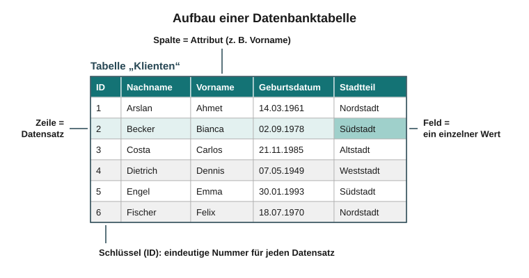

<!-- data-type="none" -->
| Begriff                     | Bedeutung                                                            |
| --------------------------- | -------------------------------------------------------------------- |
| **Spalte / Feldname / Attribut** | eine Informationskategorie, z. B. „Wohnort“                    |
| **Zeile / Datensatz**       | alle Informationen zu einem Objekt, z. B. zu einer Person            |
| **Feld**                    | genau eine Informationseinheit, z. B. „Südstadt“                      |
| **ID (Schlüssel)**          | eindeutige Nummer je Datensatz, meist automatisch vergeben           |

Die ID ist nötig, weil zwei Datensätze in allen anderen Feldern identisch sein
könnten – etwa zwei Personen mit gleichem Namen und Geburtsdatum.


### 5.3 Tabellen verknüpfen

Beziehungen zwischen Tabellen werden über die **ID** hergestellt. So lässt sich z. B.
abbilden, welche Fachkraft welche Klienten betreut.


Ohne die Daten betrachtet, ergibt sich daraus das **Datenbankschema**: Es
beschreibt, welche Tabellen es gibt, welche Spalten sie haben und wie sie
zusammenhängen.

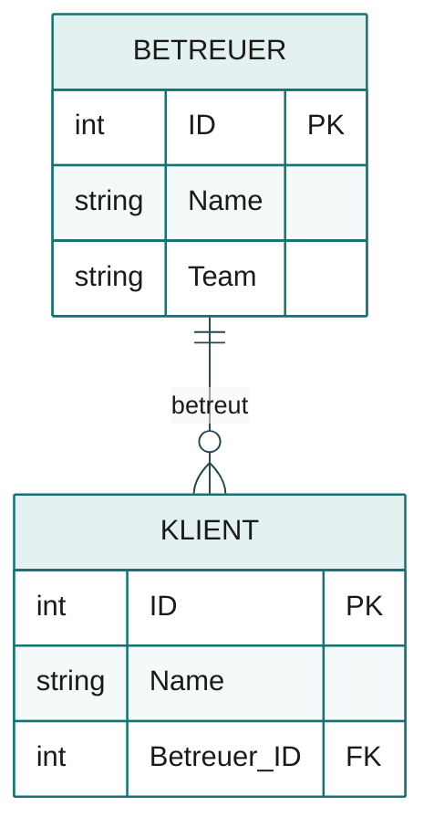

Gelesen: Ein Betreuer betreut keinen, einen oder mehrere Klienten; jeder Klient
hat genau einen Betreuer. **PK** (_Primary Key_) markiert den Schlüssel einer
Tabelle, **FK** (_Foreign Key_) einen Verweis auf den Schlüssel einer anderen
Tabelle.

Wechselt die Betreuung, muss nichts neu eingegeben werden – nur die Verknüpfung
wird geändert.

**Ausprobieren:** Wer betreut wen? Ändern Sie die `betreuer_id` eines Klienten.

```python
# Tabelle 1: Betreuer. Jeder Datensatz hat eine eindeutige ID.
betreuer = [
    {"id": 1, "name": "Schulz",    "team": "Jugend"},
    {"id": 2, "name": "Hoffmann",  "team": "Familie"},
    {"id": 3, "name": "König",     "team": "Senioren"},
]

# Tabelle 2: Klienten. Das Feld "betreuer_id" ist die Verknüpfung:
# Es enthält die ID des zuständigen Betreuers aus Tabelle 1.
# Ändern Sie z. B. bei Becker die 2 in eine 3 – das ist ein Betreuerwechsel.
klienten = [
    {"id": 1, "name": "Arslan",    "betreuer_id": 1},
    {"id": 2, "name": "Becker",    "betreuer_id": 2},
    {"id": 3, "name": "Costa",     "betreuer_id": 2},
    {"id": 4, "name": "Dietrich",  "betreuer_id": 3},
    {"id": 5, "name": "Engel",     "betreuer_id": 3},
    {"id": 6, "name": "Fischer",   "betreuer_id": 2},
]

# Äußere Schleife: jeden Betreuer nacheinander durchgehen.
for b in betreuer:
    namen = []
    # Innere Schleife: alle Klienten prüfen, ob ihre betreuer_id
    # mit der ID des aktuellen Betreuers übereinstimmt.
    for k in klienten:
        if k["betreuer_id"] == b["id"]:
            namen.append(k["name"])
    print(f"{b['name']} betreut: {', '.join(namen)}")

# Beachten Sie: Für den Betreuerwechsel mussten Sie nur EINE Zahl ändern,
# keinen Namen und keine Adresse neu eintippen.
```
@Pyodide.eval


### 5.4 Mehrbenutzerbetrieb und SQL

Datenbanken sind **mehrbenutzerfähig**: Viele Personen können gleichzeitig darauf
zugreifen. Ein **Rechtesystem** legt fest, wer welche Informationen sehen darf.

Im professionellen Umfeld werden **SQL-** bzw. **Client-Server-Datenbanken**
eingesetzt:

<!-- data-type="none" -->
| Typ          | Beispiele                       |
| ------------ | ------------------------------- |
| kommerziell  | Microsoft SQL Server, Oracle Database |
| Open Source  | MySQL                           |

**SQL** (Structured Query Language) ist eine standardisierte Abfragesprache, mit der
Programme auf Datenbanken zugreifen. Die Abfrage aus Abschnitt 2.8 sähe in SQL so
aus:

```sql
SELECT name
FROM   adressaten
WHERE  geschlecht = 'm' AND arbeitslos = 1;
```


### Quiz: Datenbanken

Wie heißt die Informationsmenge in **einer Zeile** einer Datenbanktabelle?

[[Datensatz]]

Warum braucht jeder Datensatz eine eindeutige ID?

- [( )] Damit die Tabelle alphabetisch sortiert werden kann.
- [(X)] Weil zwei Datensätze in allen übrigen Feldern identisch sein können.
- [( )] Weil Datenbanken keine Namen speichern dürfen.
- [( )] Damit die Datenbank weniger Speicher braucht.

Klientin Becker wechselt von Betreuer Hoffmann zu Betreuerin König. Was muss in der
Datenbank geändert werden?

- [( )] Der Datensatz von Frau Becker muss gelöscht und neu angelegt werden.
- [(X)] Nur die Verknüpfung (die Betreuer-ID bei Frau Becker).
- [( )] Die Tabelle der Betreuer muss neu aufgebaut werden.


## 6 Arbeitsaufgaben

Bearbeiten Sie die folgenden Fragen schriftlich. Ihre Antworten werden nur lokal
in Ihrem Browser gespeichert. Öffnen Sie den Lösungsvorschlag erst, wenn Sie eine
eigene Antwort formuliert haben.

**Aufgabe 1:** Ist die Aufnahme eines Jugendlichen in eine stationäre Einrichtung
der Kinder- und Jugendhilfe ein klassischer Algorithmus im Sinne der Informatik?
Begründen Sie Ihre Antwort.

[[___ ___ ___ ___]]

<details>
<summary>Lösungsvorschlag</summary>

Nur in Teilen. Formale Schritte wie Antragsprüfung, Kostenzusage oder Aufnahme-
dokumentation lassen sich als eindeutige Schrittfolge beschreiben. Die
eigentliche Entscheidung beruht aber auf fachlicher Einschätzung, Aushandlung mit
Jugendlichem, Familie und Jugendamt sowie auf Faktoren, die sich nicht eindeutig
und vollständig beschreiben lassen. Damit fehlen die Kennzeichen Eindeutigkeit
und feste Regelhaftigkeit (vgl. 2.1 und 3.1).

</details>

**Aufgabe 2:** Ihre Einrichtung hat fünf Standorte im Stadtgebiet, jeder mit
eigenem LAN, eigenen PCs und Server. Der einzige Administrator pendelt ständig
zwischen den Standorten, es entstehen lange Wartezeiten. Statt eine zweite Stelle
zu schaffen: Welche mittelfristig kostengünstigere Alternative gibt es?

[[___ ___ ___ ___]]

<details>
<summary>Lösungsvorschlag</summary>

Zentralisierung per **Server Based Computing**: Die Server werden an einem Ort
(oder in einem Rechenzentrum bzw. einer Private Cloud) zusammengefasst, die
Standorte werden per **VPN** oder MPLS verbunden, an den Arbeitsplätzen stehen
**Thin Clients**. Software wird nur noch zentral gepflegt, Fahrten entfallen weitgehend,
die **TCO** sinkt (vgl. 4.3, 4.4 und 4.6).

</details>

**Aufgabe 3:** Ein begeisterter Informatiker will eine Software entwickeln, die nach
Eingabe aller Familienmitglieder mit ihren Problemen und Ressourcen automatisch
die beste Hilfeform vorschlägt – präziser als jede Fachkraft. Was antworten Sie
ihm?

[[___ ___ ___ ___]]

<details>
<summary>Lösungsvorschlag</summary>

- Familiensysteme lassen sich nicht eindeutig und vollständig beschreiben, und
  menschliche Handlungsfreiheit entzieht sich festen Regeln (vgl. 2.1).
- Ein lernendes System bräuchte große Mengen verlässlicher Trainingsdaten und
  ein klar definiertes Erfolgskriterium – beides fehlt in der Hilfeplanung weitgehend.
- KI kann Muster in Daten finden, aber nicht reflektieren, Sinnfragen stellen
  oder kreativ neue Wege entwickeln (vgl. 3.5).
- Hilfeplanung ist ein Aushandlungsprozess mit den Beteiligten, kein reines
  Berechnungsproblem.
- Denkbar ist Software als **Unterstützung** (z. B. Strukturierung, Übersicht über
  Angebote), nicht als Ersatz der fachlichen Entscheidung.

</details>


## Literatur

- Gumm, Heinz-Peter/Sommer, Manfred: Einführung in die Informatik. München 2013.
- Horn, Christian/Kerner, Immo O./Forbrig, Peter: Lehr- und Übungsbuch Informatik,
  Band 1: Grundlagen und Überblick. Leipzig 2001.
- Rechenberg, Peter: Was ist Informatik? Eine allgemeinverständliche Einführung.
  München/Wien 2000.

**Zu Transformern und Diffusionsmodellen (Abschnitt 3.4)**

- Alammar, Jay (2018): The Illustrated Transformer.
  <https://jalammar.github.io/illustrated-transformer/>
- Alammar, Jay (2022): The Illustrated Stable Diffusion.
  <https://jalammar.github.io/illustrated-stable-diffusion/>
- Google for Developers: Machine Learning Crash Course – LLMs: Was ist ein Large
  Language Model?
  <https://developers.google.com/machine-learning/crash-course/llm/transformers?hl=de>
- Ho, Jonathan/Jain, Ajay/Abbeel, Pieter (2020): Denoising Diffusion Probabilistic
  Models. NeurIPS 33. <https://arxiv.org/abs/2006.11239>
- Rombach, Robin/Blattmann, Andreas/Lorenz, Dominik/Esser, Patrick/Ommer, Björn
  (2022): High-Resolution Image Synthesis with Latent Diffusion Models. CVPR 2022.
  <https://arxiv.org/abs/2112.10752>
- Sanderson, Grant (3Blue1Brown) (2024): Attention in transformers, step-by-step.
  <https://www.3blue1brown.com/lessons/attention>
- Vaswani, Ashish/Shazeer, Noam/Parmar, Niki/Uszkoreit, Jakob/Jones, Llion/
  Gomez, Aidan N./Kaiser, Łukasz/Polosukhin, Illia (2017): Attention Is All You
  Need. NeurIPS 30. <https://arxiv.org/abs/1706.03762>

Alle Online-Quellen abgerufen am 29.10.2026.
- Lehrbuch Sozialinformatik, Kapitel 2: Grundlagen der Informatik. Nomos.
  DOI: [10.5771/9783845298108-35](https://doi.org/10.5771/9783845298108-35)
